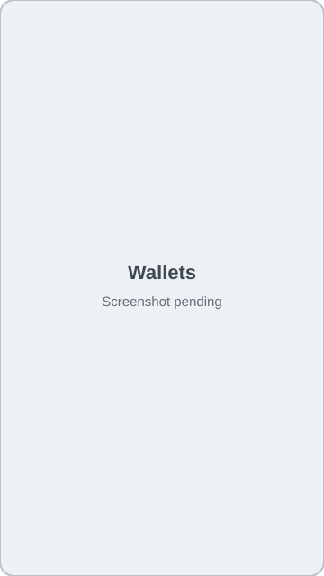
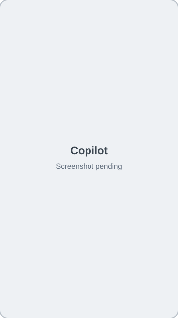
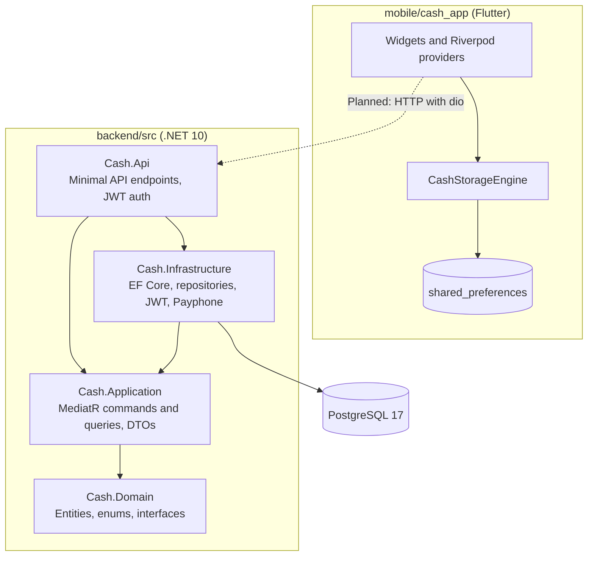

# Cash

Track personal and household expenses, budgets, card installments and savings goals.

[](LICENSE)
[](https://github.com/crisricky7/Cash/actions/workflows/build-apk.yml)
[](https://dotnet.microsoft.com/)
[](https://flutter.dev/)

**[Web demo](https://crisricky7.github.io/Cash/)**

> [!WARNING]
> The demo stores everything in your browser, including your password in plain text ([#4](https://github.com/crisricky7/Cash/issues/4)). Use a throwaway password and fake data.

## What is Cash?

Cash is an expense tracker for individuals and families, built around Ecuadorian everyday finances: amounts in USD, 15% VAT, SRI electronic invoices and local digital wallets. It has two parts that are not connected yet: a Flutter app that stores its data on the device, and a .NET 10 API backed by PostgreSQL. The interface is in Spanish.

Cash is a personal project under active development. It is not deployed to production: there is no hosted backend, and it holds no real user data.

## Features

### Flutter app

These features work on the device, using local storage:

- Local registration and login, with a separate workspace per email address
- Accounts and wallets, with balances and transfers
- Income and expense categories with monthly budgets
- Free-text entry: `Almuerzo 8.50 deuna` becomes an expense with a detected amount, account and category
- Transaction list with search and a filter by household member
- Invoice entry, by hand or by pasting SRI XML
- Credit card installments, savings goals and recurring bills
- 50/30/20 breakdown and small-expense ("gastos hormiga") detection
- Household members and an equal expense split
- CSV export to the clipboard
- Short financial tips in a stories format
- Dark mode and a responsive layout for mobile and web

### .NET API

| Area | Endpoints | What they do |
|---|---|---|
| Auth | `POST /api/auth/register`, `POST /api/auth/login` | Create users and issue JWTs |
| Dashboard | `GET /api/dashboard` | Balance, monthly totals, spending by member, budgets, recent transactions |
| Transactions | `POST /api/transactions` | Record a transaction and update the account balance |
| Catalogs | `GET /api/catalogs`, `POST` and `DELETE` under `/api/catalogs/accounts` and `/api/catalogs/categories` | Manage accounts and categories |
| Reports | `GET /api/reports/export-csv` | Export recent transactions |
| Invoices | `POST /api/smart/parse-invoice` | Split out 15% VAT and suggest a category from keywords |

### Current limitations

| Area | Status |
|---|---|
| App and API integration | Not connected. The app makes no network calls. Planned. |
| Payments | Simulated. The app activates a plan without charging. The API approves Payphone confirmations when no token is set, and its RevenueCat verification always succeeds. |
| Fingerprint login | Simulated. It waits briefly and logs in without checking anything ([#4](https://github.com/crisricky7/Cash/issues/4)). |
| Invoice reading | XML is parsed from pasted text. There is no OCR or camera capture. OCR is listed under Ideas in the roadmap. |
| Invitations | The app copies a link to the clipboard. No email is sent, and the link is not handled yet. The API keeps invitations and stories in memory. |
| Authentication | Passwords are unsalted SHA-256 in the API and plain text on the device, and the role can be chosen at registration ([#4](https://github.com/crisricky7/Cash/issues/4)). |
| API data | Not scoped by user: every authenticated user sees the same accounts ([#5](https://github.com/crisricky7/Cash/issues/5)). |
| Known bugs | Account transfers return 500 in the API, and CSV fields are not escaped ([#6](https://github.com/crisricky7/Cash/issues/6)). |
| Unpersisted entities | Installments, goals, recurring bills, subscriptions, invitations and stories have domain entities but no database tables in the API. |
| Tests | None yet ([#2](https://github.com/crisricky7/Cash/issues/2), [#3](https://github.com/crisricky7/Cash/issues/3)). |

## Screenshots

| Today | Wallets |
|---|---|
|  |  |

| Copilot | Family and plans |
|---|---|
|  |  |

## Architecture

The backend follows Clean Architecture. `Cash.Domain` has no project dependencies, and it defines the entities and the repository and unit-of-work interfaces. `Cash.Application` holds the use cases, and `Cash.Infrastructure` implements those interfaces with EF Core and PostgreSQL.

Reads and writes follow CQRS through MediatR, with one handler per request:

- **Commands:** `LoginCommand`, `RegisterMemberCommand`, `CreateTransactionCommand`
- **Queries:** `GetDashboardQuery`, `GetCatalogsQuery`

Both sides use the same database. The other endpoints, such as account and category management, still call `IUnitOfWork` directly from `Cash.Api`. Moving them behind handlers is planned.



## Tech stack

| Area | Technology |
|---|---|
| Backend | .NET 10, ASP.NET Core Minimal APIs |
| Application | MediatR |
| Data | Entity Framework Core, Npgsql, PostgreSQL 17 |
| Auth | JWT bearer tokens |
| Mobile and web | Flutter (stable channel), Dart 3.2 or later |
| State and storage | Riverpod, shared_preferences |
| Local infrastructure | Docker Compose (PostgreSQL only) |
| CI/CD | GitHub Actions, GitHub Pages |

## Getting started

### Prerequisites

- [.NET 10 SDK](https://dotnet.microsoft.com/download)
- [Docker](https://www.docker.com/) with Compose
- [Flutter](https://docs.flutter.dev/get-started/install) (stable channel)
- JDK 17, only to build the Android APK

### Backend

```bash
git clone https://github.com/crisricky7/Cash.git
cd Cash
cp .env.example .env
```

Edit `.env` and set your own values:

| Variable | Required | Purpose |
|---|---|---|
| `POSTGRES_PASSWORD` | Yes | PostgreSQL password |
| `POSTGRES_USER`, `POSTGRES_DB` | No | PostgreSQL user and database. Default to `postgres` and `cash_db`. |
| `POSTGRES_PORT` | No | PostgreSQL host port. Defaults to `5432`. |
| `ConnectionStrings__DefaultConnection` | Yes | API connection string. Must match the values above. |
| `Jwt__Secret` | Yes | JWT signing key of at least 32 bytes. Generate one with `openssl rand -hex 32`. |
| `Payphone__Token`, `Payphone__StoreId` | No | Payphone credentials. Without a token, confirmations are simulated. |

Start PostgreSQL, then the API:

```bash
docker compose up -d
dotnet run --project backend/src/Cash.Api
```

Docker Compose only starts PostgreSQL. The API runs on your machine at `http://localhost:5000` and creates its tables on first start. It stops with an error if a required variable is missing.

### Flutter app

The platform folders are not committed, so generate them first. `flutter create` can change existing files, so restore those afterwards. CI follows the same steps.

```bash
cd mobile/cash_app
flutter create . --platforms=android,ios,web --project-name cash_app
git checkout -- lib/main.dart pubspec.yaml
flutter pub get
flutter run -d chrome
```

The app does not need the backend.

## Project structure

```text
Cash/
├── .github/workflows/
│   └── build-apk.yml          # Builds the APK and deploys the web app to Pages
├── backend/src/
│   ├── Cash.Api/              # Minimal API endpoints, startup, configuration
│   ├── Cash.Application/      # MediatR commands and queries, DTOs
│   ├── Cash.Domain/           # Entities, enums, repository interfaces
│   └── Cash.Infrastructure/   # EF Core, repositories, JWT, Payphone
├── docs/screenshots/          # README screenshots
├── mobile/cash_app/
│   ├── lib/main.dart          # The whole Flutter app
│   └── pubspec.yaml
├── .env.example               # Environment variable template
├── docker-compose.yml         # Local PostgreSQL
├── CHANGELOG.md
├── CONTRIBUTING.md
└── LICENSE
```

## Roadmap

All of these items are planned.

### Near-term

- [ ] [#2](https://github.com/crisricky7/Cash/issues/2) Add backend tests and coverage, and run them in CI
- [ ] [#3](https://github.com/crisricky7/Cash/issues/3) Add Flutter tests for `SmartInputParser` and `CashStorageEngine`
- [ ] [#4](https://github.com/crisricky7/Cash/issues/4) Harden authentication in the API and the app
- [ ] [#5](https://github.com/crisricky7/Cash/issues/5) Scope API data per user or household
- [ ] [#6](https://github.com/crisricky7/Cash/issues/6) Fix account transfers and CSV escaping
- [ ] [#7](https://github.com/crisricky7/Cash/issues/7) Split `main.dart` into feature modules
- [ ] [#8](https://github.com/crisricky7/Cash/issues/8) Document the API with OpenAPI and add architecture notes

### Mid-term

- [ ] Connect the Flutter app to the API
- [ ] Add EF Core migrations, and persist installments, goals and recurring bills
- [ ] Offline support: a local cache that syncs with the API
- [ ] Internationalization in English and Spanish
- [ ] Accessibility: screen reader labels, contrast and text scaling
- [ ] Performance: paginated transaction lists and database-side aggregation

### Ideas

- [ ] Read invoices from photos with OCR
- [ ] Reminders for recurring bills and installment due dates

## Contributing

See [CONTRIBUTING.md](CONTRIBUTING.md).

## License

Released under the [MIT License](LICENSE). Copyright (c) 2026 Ricardo Muñoz.
